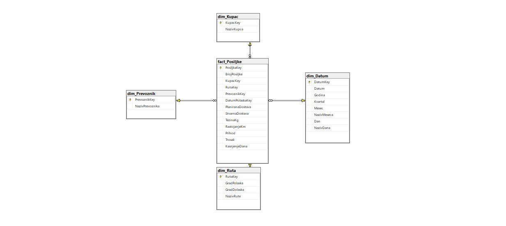
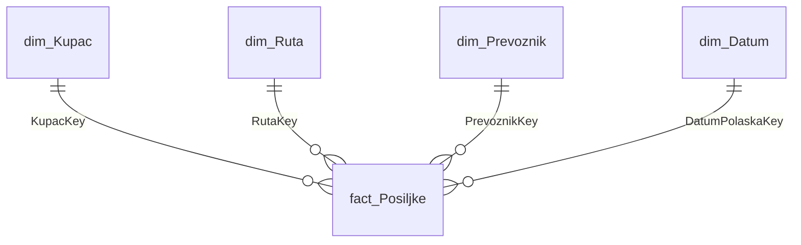
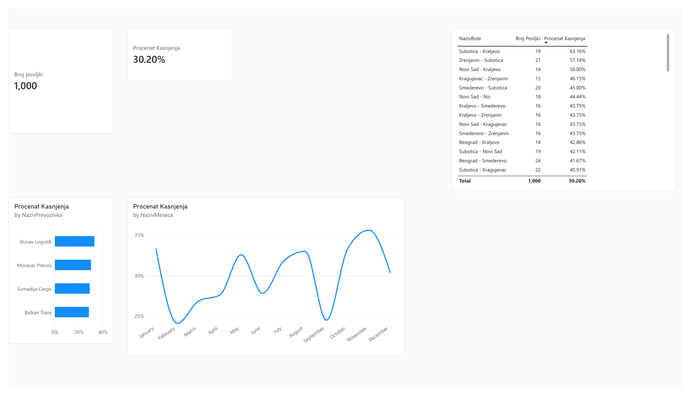
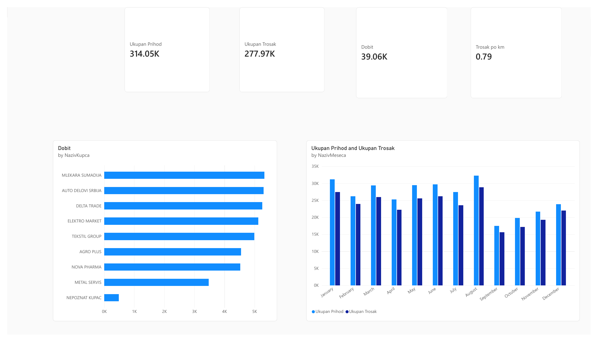
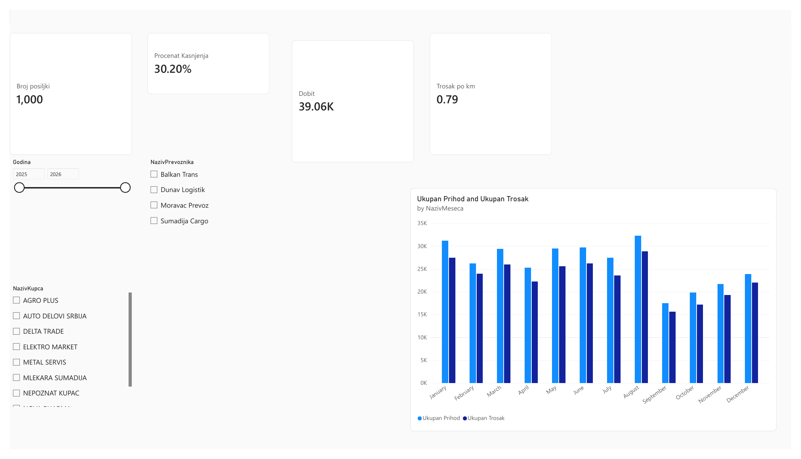

# Logistički Data Warehouse (SQL Server + T-SQL ETL + Power BI)

Kućni projekat koji simulira malo skladište podataka (data warehouse) za špeditersku/transportnu kompaniju: od sirovih, „prljavih" podataka o pošiljkama, preko ETL-a u T-SQL-u i zvezda šeme, do tri Power BI izveštaja (operativni, finansijski i menadžerski).

**Stack:** SQL Server 2022 Express · T-SQL (stored procedure) · SSMS · Power BI Desktop (Power Query, DAX)

---

## 1. Problem koji projekat rešava

Podaci o pošiljkama stižu iz izvora u sirovom obliku: prazna polja, različiti formati datuma, nazivi kupaca pisani na više načina, nedostajući prihodi i duplikati. Direktno izveštavanje nad takvim podacima daje pogrešne brojke.

Cilj je da se podaci:
1. učitaju u **staging** sloj bez izmena,
2. **očiste i transformišu** ponovljivim ETL procesom,
3. smeste u **zvezda šemu** pogodnu za analitiku,
4. prikažu u izveštajima koje koriste operativa, finansije i menadžment.

## 2. Arhitektura i tok podataka

```
stg_Posiljke (sirovi tekst)  ->  usp_Ucitaj_Dimenzije  ->  dim_Kupac / dim_Ruta / dim_Prevoznik / dim_Datum
                             ->  usp_Ucitaj_Cinjenice  ->  fact_Posiljke
                                  (oba pozvana iz usp_Pokreni_ETL, u jednoj transakciji)
                                                       ->  Power BI (model + DAX mere + izveštaji)
```

### Zvezda šema





- **Tabela činjenica:** `fact_Posiljke` (jedan red = jedna pošiljka).
- **Dimenzije:** `dim_Kupac`, `dim_Ruta`, `dim_Prevoznik`, `dim_Datum`.
- Dimenzije koriste **surogat ključeve** (`IDENTITY`); `dim_Datum` koristi ključ oblika `yyyymmdd` (npr. 20250124).

## 3. ETL — šta je tačno urađeno

| Problem u sirovim podacima | Rešenje u T-SQL-u |
|---|---|
| Prazan kupac (NULL) | `ISNULL(NULLIF(...), 'NEPOZNAT KUPAC')` |
| Kupac velikim/malim slovima, razmaci | `UPPER(LTRIM(RTRIM(...)))` |
| Datum u formatu `dd.mm.gggg` pored `gggg-mm-dd` | `COALESCE(TRY_CONVERT(DATE, x, 23), TRY_CONVERT(DATE, x, 104))` |
| Prihod = „N/A" | `TRY_CAST(... AS DECIMAL)` daje `NULL`, red se ne odbacuje |
| Duplikati pošiljki | `ROW_NUMBER() OVER (PARTITION BY BrojPosiljke ...)`, uzima se `rn = 1` |
| Ponovno pokretanje ETL-a | Idempotentnost preko `NOT EXISTS` — nema duplih redova |
| Greška usred učitavanja | `BEGIN TRY / TRANSACTION / ROLLBACK / THROW` u `usp_Pokreni_ETL` |

Kašnjenje se računa u ETL-u: `KasnjenjeDana = DATEDIFF(DAY, PlaniranaDostava, StvarnaDostava)`.

**Provera ETL-a (rezultati):**

| Provera | Rezultat |
|---|---|
| Redova u stagingu (sa duplikatima) | 1020 |
| Različitih pošiljki | 1000 |
| Pošiljki u `fact_Posiljke` | 1000 (i posle ponovnog pokretanja, i posle učitavanja od nule) |
| Pošiljki bez prihoda | 10 |
| Pošiljki koje kasne | 302 (30,2 %) |

## 4. Kako pokrenuti projekat

Potrebno: SQL Server (Express je dovoljan), SSMS, Power BI Desktop. Skripte se pokreću redom u SSMS-u:

| # | Skripta | Šta radi |
|---|---|---|
| 1 | `01_kreiranje_baze_i_staging.sql` | Kreira bazu `LogistikaDW` i staging tabelu |
| 2 | `02_generisanje_podataka.sql` | Generiše 1000 sintetičkih pošiljki (2025) |
| 3 | `03_prljavi_podaci.sql` | Namerno kvari podatke (NULL, formati, „N/A", duplikati) |
| 4 | `04_zvezda_sema.sql` | Kreira dimenzije i tabelu činjenica |
| 5 | `05_etl_dimenzije.sql` | Procedura `usp_Ucitaj_Dimenzije` |
| 6 | `06_etl_cinjenice.sql` | Procedura `usp_Ucitaj_Cinjenice` |
| 7 | `07_pokretanje_etl.sql` | `usp_Pokreni_ETL` (transakcija) + testovi ponovljivosti |
| 8 | `08_upiti_za_analizu.sql` | Analitički upiti (JOIN, GROUP BY, HAVING, `RANK()`) |

Zatim otvoriti `LogistikaDW.pbix` i u Power BI-ju podesiti izvor (server/instanca) na lokalni SQL Server (Transform data → Data source settings), pa Refresh.

> Podaci su sintetički (generisani skriptom), ne predstavljaju stvarnu kompaniju.

## 5. Power BI model, Power Query i DAX

- **Model:** zvezda šema, veze 1:N od dimenzija ka `fact_Posiljke`, Import mod.
- **Power Query:** dodata kolona `StatusIsporuke`: `if [KasnjenjeDana] > 0 then "Kasni" else "Na vreme"`.
- **Sortiranje:** `NazivMeseca` sortiran po koloni `Mesec` (januar → decembar umesto abecedno).

Glavne DAX mere:

```dax
Broj Posiljki     = COUNTROWS(fact_Posiljke)
Ukupan Prihod     = SUM(fact_Posiljke[Prihod])
Ukupan Trosak     = SUM(fact_Posiljke[Trosak])
Dobit             = SUMX(fact_Posiljke,
                      IF(NOT ISBLANK(fact_Posiljke[Prihod]),
                         fact_Posiljke[Prihod] - fact_Posiljke[Trosak]))
Procenat Kasnjenja = DIVIDE(CALCULATE([Broj Posiljki], fact_Posiljke[KasnjenjeDana] > 0),
                            [Broj Posiljki])
Trosak po km      = DIVIDE(SUM(fact_Posiljke[Trosak]), SUM(fact_Posiljke[RastojanjeKm]))
```

Napomena o meri `Dobit`: pošiljke bez prihoda („N/A") se isključuju iz dobiti, jer bi inače njihov trošak veštački smanjio dobit. Vrednost je proverena u SQL-u (**39.062,47**) i poklapa se sa Power BI-jem (39,06K).

## 6. Izveštaji

### Operativni — pošiljke i kašnjenja
Broj pošiljki, procenat kašnjenja, kašnjenje po prevozniku, trend po mesecima i tabela ruta sortirana po kašnjenju.



### Finansijski — prihod, trošak, dobit
Ukupan prihod (314,05K), trošak (277,97K), dobit (39,06K), trošak po km (0,79), dobit po kupcu i prihod/trošak po mesecima.



### Menadžerski — KPI pregled
Ključni pokazatelji na jednom mestu uz filtere po godini, kupcu i prevozniku.



## 7. Rečnik podataka

**fact_Posiljke**

| Kolona | Tip | Opis |
|---|---|---|
| PosiljkaKey | INT (PK, identity) | Surogat ključ |
| BrojPosiljke | VARCHAR(50) | Poslovni ključ (npr. PO00001) |
| KupacKey / RutaKey / PrevoznikKey | INT (FK) | Veze ka dimenzijama |
| DatumPolaskaKey | INT (FK) | Veza ka `dim_Datum` (yyyymmdd) |
| PlaniranaDostava, StvarnaDostava | DATE | Planirani i stvarni datum isporuke |
| TezinaKg | DECIMAL(10,2) | Težina pošiljke |
| RastojanjeKm | DECIMAL(10,2) | Pređeni put |
| Prihod | DECIMAL(10,2), NULL | NULL ako je u izvoru bilo „N/A" |
| Trosak | DECIMAL(10,2) | Trošak prevoza |
| KasnjenjeDana | INT | `StvarnaDostava − PlaniranaDostava` (>0 = kasni) |

**dim_Kupac** — `KupacKey`, `NazivKupca` (očišćen, velika slova; 9 vrednosti uključujući „NEPOZNAT KUPAC").
**dim_Ruta** — `RutaKey`, `GradPolaska`, `GradDolaska`, `NazivRute` (npr. „Beograd - Nis"); 56 ruta.
**dim_Prevoznik** — `PrevoznikKey`, `NazivPrevoznika`; 4 prevoznika.
**dim_Datum** — `DatumKey`, `Datum`, `Godina`, `Kvartal`, `Mesec`, `NazivMeseca`, `Dan`, `NazivDana`; 730 dana (2025–2026).

## 8. Moguća proširenja

- Zameniti T-SQL ETL SSIS paketom ili Azure Data Factory pipeline-om.
- Dodati inkrementalno učitavanje i SCD tip 2 za dimenzije.
- Dodati dimenzije vozila i tipa usluge, SSRS verziju izveštaja.
